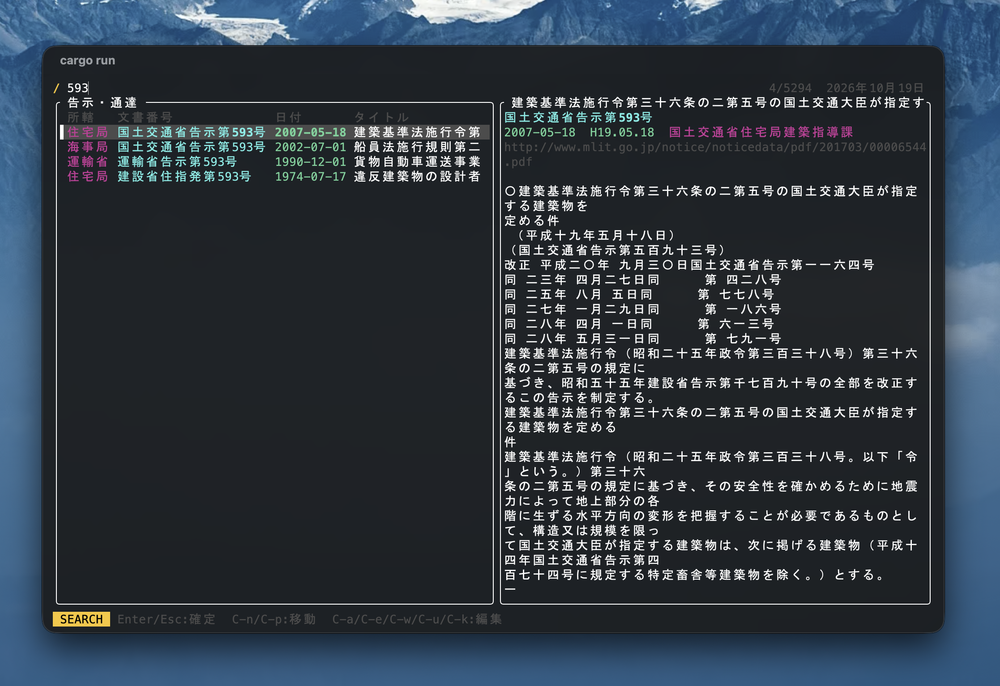

# mlit-kokuji

[国交省のWebサイト](https://www.mlit.go.jp/notice/)で配布されている告示・通達一覧（Excel）を取得し、告示を検索・表示・ダウンロードする CLI ツールです。

告示番号 1024 は資料によって

- `1024` / `１０２４`
- `千二十四`
- `一〇二四`

などと表記されますが、すべて半角数字 `1024` に正規化されるので、どの表記でも同じように検索できます。



## Install

### Homebrew（macOS / Linux）

```sh
brew tap riffst-jp/mlkokuji
brew install mlkokuji
```

アップデートは `brew upgrade mlkokuji` です。

### ビルド済みバイナリ

[Releases](https://github.com/riffst-jp/mlit-kokuji/releases) から環境に合ったファイルをダウンロードし、展開した `mlkokuji` を `PATH` の通ったディレクトリに置いてください。

| 環境                  | ファイル                                           |
| --------------------- | -------------------------------------------------- |
| macOS (Apple Silicon) | `mlkokuji-vX.Y.Z-aarch64-apple-darwin.tar.gz`      |
| macOS (Intel)         | `mlkokuji-vX.Y.Z-x86_64-apple-darwin.tar.gz`       |
| Linux (x86_64)        | `mlkokuji-vX.Y.Z-x86_64-unknown-linux-gnu.tar.gz`  |
| Linux (ARM64)         | `mlkokuji-vX.Y.Z-aarch64-unknown-linux-gnu.tar.gz` |

macOS でブラウザからダウンロードした場合、署名が無いため初回実行がブロックされます。次のコマンドで解除してください。

```sh
xattr -d com.apple.quarantine /path/to/mlkokuji
```

### ソースから

```sh
cargo install --git https://github.com/riffst-jp/mlit-kokuji
```

初回起動時に告示一覧を自動で取得します（`mlkokuji update` で手動取得も可能）。

## Usage

| Command                    | Does                                                                                 |
| -------------------------- | ------------------------------------------------------------------------------------ |
| `mlkokuji`                 | インタラクティブ検索（左に所轄・文書番号・日付・タイトル、右に本文プレビュー）       |
| `mlkokuji show 1024`       | 告示を開く（PDF は既定の PDF ビューア、HTML はブラウザ）。複数該当すれば一覧から選択 |
| `mlkokuji get 1024`        | 告示を保存先ディレクトリにダウンロード。複数該当すれば一覧から選択（`d` で保存）     |
| `mlkokuji get 1024 -o DIR` | 保存先を指定してダウンロード（`--all` で該当分すべて）                               |
| `mlkokuji list [検索語]`   | タブ区切りで一覧を出力（設定 `ui.columns` の列 + URL）                               |
| `mlkokuji update`          | 国交省サイトから一覧を再取得                                                         |
| `mlkokuji config`          | 設定ファイルの場所と内容を表示（`--init` で作成、`--edit` で編集）                   |
| `mlkokuji clean`           | キャッシュを削除                                                                     |

### 検索語

- 空白区切りで AND 検索（`1446 建設省`）
- 数字だけの語は文書番号中の数字と完全一致（`593` は `第593号` にマッチし、`第5930号` にはマッチしない）
- `!語` で除外（`1024 !通達`）
- 和暦でも検索可（`h12`, `平成12年`）

### インタラクティブモード

起動直後は検索入力（SEARCH モード）で、そのまま文字を打てば絞り込めます。`Enter` / `Esc` で NORMAL モードに移ってキー操作ができ、`/` で再び検索入力に戻ります。NORMAL モードで起動したい場合は設定で `start_in_search = false` にしてください。

| Key                                   | Does                                  |
| ------------------------------------- | ------------------------------------- |
| `j` `k` `↓` `↑` `C-n` `C-p`           | 上下に移動                            |
| `C-d` `C-u` / `C-f` `C-b` `C-v` `M-v` | 半ページ / 1ページ移動                |
| `G` `M->` / `gg` `Home` `M-<`         | 末尾 / 先頭へ                         |
| `J` `K` `C-e` `C-y` / `Space` `BS`    | プレビューを 1 行 / 10 行スクロール   |
| `Enter`                               | 告示を開く（PDF はプレビュー.app 等） |
| `d`                                   | ダウンロード                          |
| `P`                                   | プレビュー表示の切り替え              |
| `u`                                   | 国交省サイトからデータ再取得          |
| `/` `i`                               | 検索入力                              |
| `x`                                   | 検索語をクリア                        |
| `?`                                   | ヘルプ                                |
| `q` `Esc` `C-c`                       | 終了                                  |

SEARCH モードでは Emacs 風の行編集（`C-a` `C-e` `C-b` `C-f` `C-h` `C-d` `C-w` `C-u` `C-k` `M-b` `M-f`）が使えます。

表示する列は設定 `ui.columns` で選べます（所轄・組織名・文書番号・日付・和暦・タイトル）。文書番号は既定で半角英数字に整形して表示し、`ui.normalize_number = false` で原文表記のままにできます（検索はどちらでも表記揺れを吸収します）。

「所轄」は組織名を局レベルに短縮したものです（例: 国土交通省住宅局建築指導課 → 住宅局）。完全な組織名はプレビュー欄に表示されます。

起動時に国交省サイトを確認し、一覧が更新されていれば右上に **Available update** と表示されます。`u` で取り込めます。

PDF のプレビューは組み込みの抽出器で表示します。`pdftotext`（`brew install poppler`）がインストールされていればそちらを優先して使います。

### 注意

検索対象は国交省サイトの告示・通達一覧に掲載されているものだけです。サイトにも「すべての告示・通達等を網羅している訳ではありません」とあるとおり、一覧に無い告示（例: 平成13年国土交通省告示第1024号）は検索できません。

## Settings

設定ファイルは `$XDG_CONFIG_HOME/mlkokuji/config.toml`（既定: `~/.config/mlkokuji/config.toml`）です。`mlkokuji config --init` で既定値入りのファイルを作成できます。

```toml
[ui]
# インタラクティブウィンドウの高さ。"100%" で全画面、"40%" で端末の40%、"20" で20行
height = "100%"
# 起動時にプレビューを表示する（P で切り替え）
preview = true
# プレビューの幅（%）
preview_width = 50
# 起動時に検索入力（SEARCH）モードで始める。false なら NORMAL モードで始める
start_in_search = true
# 起動時に国交省サイトの更新を確認する
check_update = true
# 一覧に表示する列（左から順に）。`mlkokuji list` の出力にも使われる
#   "org"      所轄（局レベルに短縮した組織名。例: 住宅局）
#   "org_full" 組織名（原文。例: 国土交通省住宅局建築指導課）
#   "number"   文書番号
#   "date"     日付（2000-05-31）
#   "era"      和暦（H12.05.31）
#   "title"    タイトル
columns = ["org", "number", "date", "title"]
# 文書番号を半角英数字に整形して表示する（例: 建設省告示第千四百四十六号 → 建設省告示第1446号）
# false なら原文のまま表示する。検索はどちらの場合も表記揺れを吸収する
normalize_number = true

[download]
# `mlkokuji get` / `d` キーでの保存先
dir = "~/Downloads"

[cache]
# キャッシュディレクトリ。空なら $XDG_CACHE_HOME/mlkokuji (~/.cache/mlkokuji)
dir = ""
```

環境変数 `MLKOKUJI_CACHE_DIR` でもキャッシュディレクトリを指定できます（設定ファイルの `cache.dir` が優先）。

## Release（開発者向け）

`Cargo.toml` の `version` を上げてコミットし、同じバージョンのタグを push すると、GitHub Actions（`.github/workflows/release.yml`）が各環境向けにビルドして Release を作成し、Homebrew tap の Formula を更新します。

```sh
git tag v2.0.0
git push origin v2.0.0
```

tap（`riffst-jp/homebrew-mlkokuji`）の更新には deploy key を使います。初回だけ次の手順で登録してください。

```sh
ssh-keygen -t ed25519 -N "" -C "mlit-kokuji release" -f tap_deploy_key
gh repo deploy-key add tap_deploy_key.pub -R riffst-jp/homebrew-mlkokuji --allow-write --title "mlit-kokuji release"
gh secret set HOMEBREW_TAP_DEPLOY_KEY -R riffst-jp/mlit-kokuji < tap_deploy_key
rm tap_deploy_key tap_deploy_key.pub
```

未登録の場合でも Release は作成され、tap の更新だけがスキップされます。

## License

[MIT](https://choosealicense.com/licenses/mit/)
